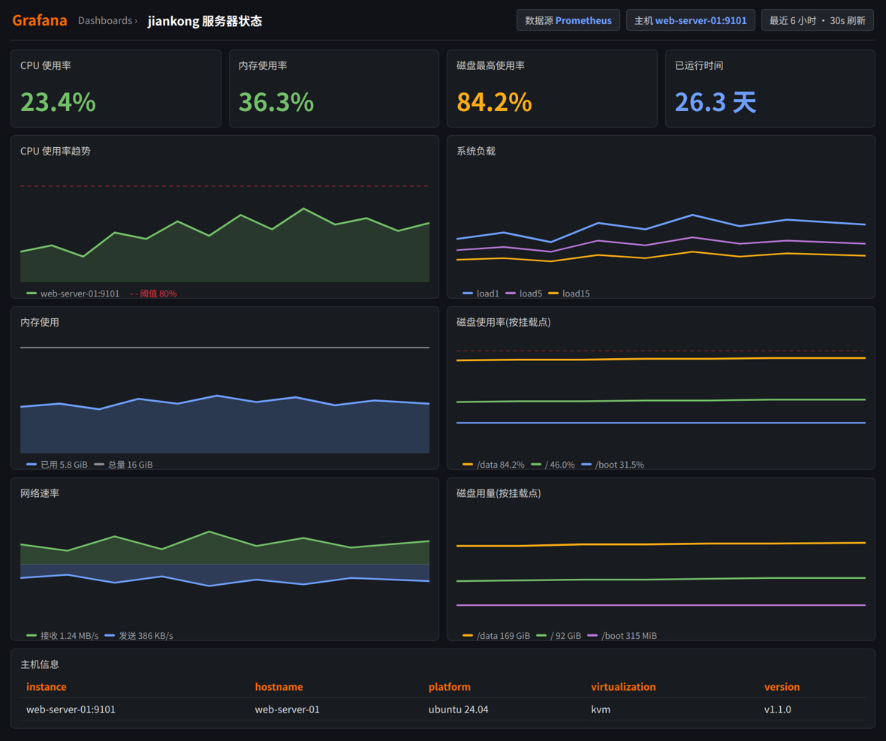
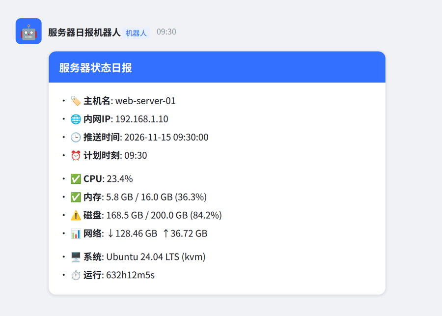

# jiankong-feishu

把一台 Linux 服务器的状态做成日报，通过飞书自定义机器人以消息卡片形式推送到群里。单文件 Go 程序、无常驻进程，配合 systemd 定时器每天定时发送一次。

推送内容：主机名、内网 IP、CPU / 内存 / 磁盘使用率（可设阈值，超限显示 ⚠️）、网络流量、系统版本与虚拟化类型、已运行时长。

同系列：钉钉版 jiankong-dingtalk、企业微信版 jiankong-wecom。

## 飞书机器人准备

1. 在目标群里：群设置 → 群机器人 → 添加机器人 → 自定义机器人
2. 安全设置建议勾选「签名校验」，保存好 Webhook 地址和签名密钥
3. 把 Webhook 填到 `FEISHU_WEBHOOK`，密钥填到 `FEISHU_SECRET`（没开签名校验可不填）

## 配置（环境变量）

| 变量 | 必填 | 默认 | 说明 |
| --- | --- | --- | --- |
| `FEISHU_WEBHOOK` | 是 | - | 飞书自定义机器人 Webhook 地址 |
| `FEISHU_SECRET` | 否 | - | 机器人签名校验密钥 |
| `CUSTOM_TITLE` | 否 | 服务器状态日报 | 卡片标题 |
| `CPU_THRESHOLD` | 否 | 80 | CPU 使用率告警阈值（%） |
| `MEM_THRESHOLD` | 否 | 80 | 内存使用率告警阈值（%） |
| `DISK_THRESHOLD` | 否 | 80 | 磁盘使用率告警阈值（%） |
| `REPORT_TIME` | 否 | - | 计划推送时刻，仅在日报中展示，实际调度由 systemd 定时器决定 |

## 使用

### 进项目根目录
```
cd jiankong-feishu
```
### 拉依赖
```
go mod tidy
```
### 编译
```
CGO_ENABLED=0 go build -ldflags "-s -w -X main.version=v1.0.0" -o jiankong-feishu .
```
### 本地运行
```
export FEISHU_WEBHOOK=https://open.feishu.cn/open-apis/bot/v2/hook/xxxxxxxx-xxxx-xxxx-xxxx-xxxxxxxxxxxx
export FEISHU_SECRET=xxxxxxxxxxxxxxxx
./jiankong-feishu
```

### systemd 管理
#### 二进制放置
```
sudo cp jiankong-feishu /usr/local/bin/
sudo chmod +x /usr/local/bin/jiankong-feishu
```

#### systemd 单元文件
```
sudo tee /etc/systemd/system/jiankong-feishu.service >/dev/null <<'EOF'
[Unit]
Description=Push server status to Feishu once
After=network-online.target
Wants=network-online.target

[Service]
Type=oneshot
Environment=FEISHU_WEBHOOK=https://open.feishu.cn/open-apis/bot/v2/hook/YOUR_TOKEN
Environment=FEISHU_SECRET=YOUR_SECRET
Environment=CPU_THRESHOLD=85
Environment=MEM_THRESHOLD=85
Environment=DISK_THRESHOLD=85
Environment=REPORT_TIME=09:30
ExecStart=/usr/local/bin/jiankong-feishu
EOF
```
#### systemd 定时器
```
sudo tee /etc/systemd/system/jiankong-feishu.timer >/dev/null <<'EOF'
[Unit]
Description=Daily jiankong to Feishu

[Timer]
OnCalendar=*-*-* 09:30:00
Persistent=true

[Install]
WantedBy=timers.target
EOF
```

### 启用并立即测试
```
sudo systemctl daemon-reload
sudo systemctl enable --now jiankong-feishu.timer
sudo systemctl start jiankong-feishu.service
journalctl -u jiankong-feishu --no-pager -e
```

## Prometheus 指标

除了推送日报，程序还带一个常驻的指标模式，把主机指标以 Prometheus 格式暴露出来，供 Prometheus 抓取、Grafana 展示。原来的推送模式不受影响。

```bash
# 直接运行（默认监听 :9101）
METRICS_ADDR=:9101 ./jiankong-feishu metrics

# 可选：给抓取加 token 鉴权（Prometheus 侧配同样的 token）
METRICS_ADDR=:9101 METRICS_TOKEN=你的token ./jiankong-feishu metrics
```

健康检查：`GET /healthz` 返回 `ok`。

用 systemd 常驻（与日报推送的 timer 并存，互不影响）：

```ini
# /etc/systemd/system/jiankong-feishu-metrics.service
[Unit]
Description=jiankong-feishu Prometheus metrics
After=network.target

[Service]
ExecStart=/opt/jiankong-feishu metrics
Environment=METRICS_ADDR=:9101
Restart=always
User=root

[Install]
WantedBy=multi-user.target
```

Prometheus 抓取配置（prometheus.yml）：

```yaml
scrape_configs:
  - job_name: jiankong
    static_configs:
      - targets: ['服务器IP:9101']
    # 设了 METRICS_TOKEN 时取消下面三行注释
    # authorization:
    #   type: Bearer
    #   credentials: 你的token
```

指标一览（每次抓取时实时采集）：

| 指标 | 说明 |
| --- | --- |
| `jiankong_cpu_usage_percent` | CPU 使用率(%) |
| `jiankong_memory_used_bytes` / `jiankong_memory_total_bytes` / `jiankong_memory_usage_percent` | 内存已用 / 总量 / 使用率 |
| `jiankong_swap_used_bytes` / `jiankong_swap_total_bytes` | 交换空间已用 / 总量 |
| `jiankong_disk_used_bytes` / `jiankong_disk_total_bytes` / `jiankong_disk_usage_percent` | 磁盘指标，带 `mountpoint` 标签按挂载点分开 |
| `jiankong_network_receive_bytes_total` / `jiankong_network_transmit_bytes_total` | 网络累计收 / 发字节，带 `device` 标签（计数器，用 `rate()` 算速率） |
| `jiankong_load1` / `jiankong_load5` / `jiankong_load15` | 系统负载 |
| `jiankong_uptime_seconds` / `jiankong_boot_time_seconds` | 已运行秒数 / 开机时间 |
| `jiankong_host_info` | 主机信息（`hostname` / `platform` / `virtualization` 标签） |
| `jiankong_build_info` | 版本信息（`version` 标签） |
| `jiankong_scrape_duration_seconds` | 本次采集耗时 |

## Grafana 看板

仓库里的 `grafana/dashboard.json` 是一份现成看板（三个 jiankong 项目（钉钉 / 飞书 / 企业微信），指标名完全一致，共用这一份）：

1. Grafana → Dashboards → New → Import
2. 上传 `grafana/dashboard.json`，选中你的 Prometheus 数据源
3. 顶部「主机」变量可按 instance 切换要看的机器

看板内容：顶部 Stat 卡（CPU / 内存 / 磁盘最高使用率、运行时长）、CPU 趋势、系统负载、内存使用、磁盘使用率与用量（按挂载点）、网络速率、主机信息表。



## 效果图



## 更新记录

## v1.1.0 (2026-11-15)

- 新增 Prometheus 指标模式：`jiankong-feishu metrics` 常驻暴露 `/metrics`（CPU / 内存 / 磁盘 / 网络 / 负载等指标），可选 token 鉴权
- 新增 Grafana 看板 `grafana/dashboard.json` 与看板预览图


### v1.0.0 (2026-11-15)
- 首个版本：服务器状态日报以飞书消息卡片推送（CPU / 内存 / 磁盘 / 网络 / 主机信息）
- 支持签名校验；推送失败（飞书 code 非 0）会正确报错退出，不会误报成功
